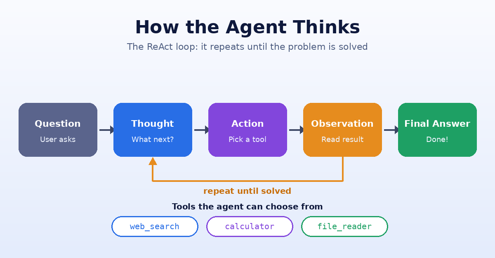

# Datheon – Python + Generative AI & LangChain

Four production-style Generative AI projects built with **Python 3**, **LangChain**, **Pydantic**, **ChromaDB** and **Streamlit**.
Every project works with **Groq, Google Gemini or OpenAI** — switch with one line in `.env`.



| # | Project | What it does | Key tech |
|---|---------|--------------|----------|
| 1 | [Structured LLM Prompt Pipeline & JSON Extractor](task1_json_extractor) | Turns invoices / resumes into **strictly validated JSON** | Parameterised prompts, few-shot, Pydantic, self-repair loop |
| 2 | [Document Q&A with RAG](task2_rag_qa) | Answers questions on your PDFs / text files **with cited sources** | Recursive chunking, embeddings, ChromaDB |
| 3 | [Multi-Tool Autonomous Agent](task3_multi_tool_agent) | Decides by itself when to search the web, calculate or read files | LangChain tool-calling agent, DuckDuckGo / Tavily |
| 4 | [Streamlit AI Chatbot](task4_streamlit_chatbot) | Web chat UI with **streaming**, memory and document mode | Streamlit, session state, reuses Task 2 |

## Repository structure
```
.
├── common/                    # shared model factory (chat + embeddings)
│   └── llm_factory.py
├── task1_json_extractor/      # schemas.py · examples.py · extractor.py · extract.py · data/
├── task2_rag_qa/              # rag_pipeline.py · rag_qa.py · data/
├── task3_multi_tool_agent/    # agent.py · tools.py · workspace/
├── task4_streamlit_chatbot/   # app.py
├── tests/                     # offline unit tests (no API key needed)
├── docs/                      # images
├── .env.example
└── requirements.txt
```

## Quick start in VS Code
1. Unzip, then **File -> Open Folder...** and select this folder (or run `code .` inside it).
2. Double-click `setup.bat` (Windows) or run `./setup.sh` (Linux/Mac) - creates `venv`, installs packages and creates `.env`.
3. Open `.env` and paste your API key.
4. In VS Code press `Ctrl+Shift+P` -> **Python: Select Interpreter** -> choose the `venv` one.
5. Open **Run and Debug** (`Ctrl+Shift+D`), pick a task from the dropdown and press the green play button.

## Setup (Python 3.10+)
```bash
git clone <your-repo-url> && cd <repo-folder>
python -m venv venv
venv\Scripts\activate            # Windows   |   Linux/Mac: source venv/bin/activate
pip install -r requirements.txt
copy .env.example .env           # Linux/Mac: cp .env.example .env
```
Open `.env`, choose `LLM_PROVIDER` (`groq`, `google` or `openai`) and paste the matching API key.
Groq and Google Gemini both offer free tiers. **Never commit `.env`** (it is in `.gitignore`).

> If a provider retires a model name, set `LLM_MODEL=<new-model>` in `.env`.

## Task 1 – Structured LLM Prompt Pipeline & JSON Extractor
**Pipeline:** document → parameterised prompt (+ JSON Schema + few-shot example) → LLM → JSON parse → **Pydantic validation** → on failure, the exact validation errors are sent back to the model (**self-repair**, up to 2 retries).

* Invoice schema checks arithmetic: `qty × price = amount`, `Σ items = subtotal`, `subtotal − discount + tax = total`, `due ≥ invoice date`.
* `extra="forbid"` rejects hallucinated keys; e-mail, date and currency formats are validated.

```bash
python task1_json_extractor/extract.py --demo                         # both bundled samples → output/*.json
python task1_json_extractor/extract.py --type invoice --file my.pdf   # your own file (.txt / .md / .pdf)
python task1_json_extractor/extract.py --type resume --provider google
```
Expected result for `data/sample_invoice.txt` (abridged): `invoice_number: "DS/2025/0147"`, `currency: "INR"`, 3 line items, `subtotal: 81000.0`, `discount: 3000.0`, `tax_amount: 14040.0`, `total: 92040.0`.

## Task 2 – Document Q&A Assistant with RAG
`PDF/TXT/MD → RecursiveCharacterTextSplitter (1000 / 150 overlap) → embeddings → ChromaDB (persistent) → top-k retrieval → grounded answer with [n] citations`

* Embeddings are **local and free** by default (FastEmbed `bge-small`); set `EMBEDDINGS_PROVIDER=google|openai` to use hosted ones.
* Re-ingesting the same file is idempotent (content-hash IDs). Follow-up questions are rewritten into standalone queries.
* If the answer is not in the documents, the assistant says so instead of guessing.

```bash
python task2_rag_qa/rag_qa.py ingest                       # index the sample handbook
python task2_rag_qa/rag_qa.py ingest report.pdf notes/     # index your own files / folders
python task2_rag_qa/rag_qa.py ask "Why is chunk overlap used?"
python task2_rag_qa/rag_qa.py chat                         # interactive with follow-ups
```

## Task 3 – Multi-Tool Autonomous AI Agent
A **function-calling (tool-calling) agent** with three tools. Every tool call carries a short 

| Tool | Purpose | Safety |
|------|---------|--------|
| `web_search` | real-time search (DuckDuckGo, or Tavily if `TAVILY_API_KEY` is set) | errors returned as text |
| `calculator` | math with `sqrt, log, sin, factorial …` | AST evaluator – **no `eval()`** |
| `file_reader` | reads txt / md / csv / json / py | sandboxed to `workspace/`, blocks `../` traversal |

`max_iterations=8` and `handle_parsing_errors=True` keep the loop robust.
```bash
python task3_multi_tool_agent/agent.py
python task3_multi_tool_agent/agent.py --query "Read sales.csv, compute total revenue, then search today's USD to INR rate and convert it"
```
Output format: `Thought → Action → Action Input → Observation → … → Final Answer`.

## Task 4 – Interactive Streamlit Chatbot
```bash
streamlit run task4_streamlit_chatbot/app.py
```
* **Streaming** token-by-token replies (`st.write_stream`)
* **Memory** via `st.session_state` (last 12 messages sent to the model)
* **General Chat** and **Document Q&A (RAG)** modes — upload PDFs in the sidebar, answers show their sources
* Provider / model / temperature controls, clear-chat and delete-knowledge-base buttons, friendly error messages

## Tests
```bash
pytest -q
```
The tests are fully offline (the LLM is faked) and cover schema validation, the self-repair loop, the safe calculator and the file-reader sandbox.

## Design decisions
* **One shared `common/llm_factory.py`** → no duplicated provider code; swapping models is a config change.
* **Validate, don't trust:** LLM output is treated as untrusted input and checked by Pydantic.
* **Guardrails everywhere:** iteration limits, path sandboxing, no `eval`, secrets only in `.env`.
* **Reuse:** the Streamlit app wraps the Task 2 RAG pipeline instead of re-implementing it.
